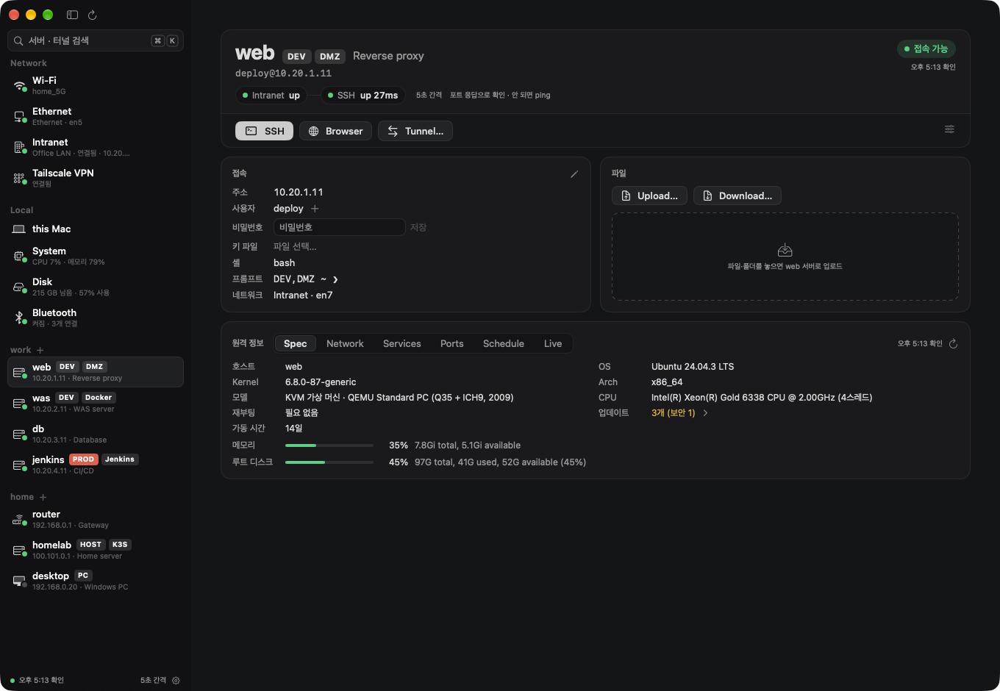
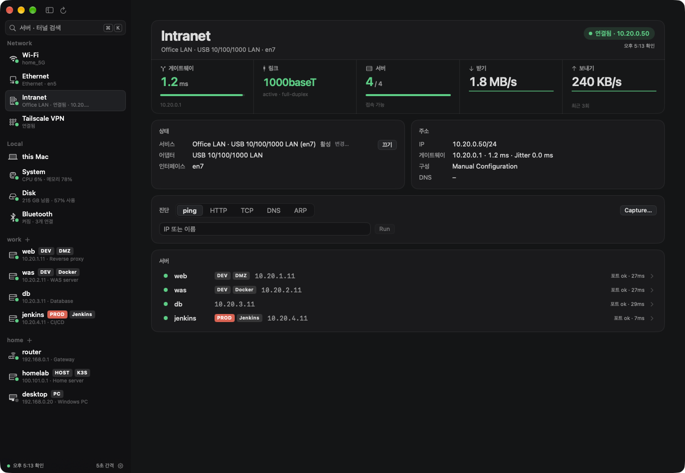

# Nexus

[](https://github.com/youseonghyeon/nexus/releases/latest)


[](LICENSE)

서버 여러 대를 한 창에서 다루는 macOS 앱입니다. 서버 상태를 지켜보다가 바로 SSH 로 들어가고, 터널을 열고, 파일을 옮기고, 망이 이상하면 그 자리에서 진단합니다.

*A native macOS dashboard for your servers — status, SSH terminal, tunnels, file transfer and network diagnostics in one window.*



## 왜 만들었나

집 서버, 회사 내부망 서버, VPN 너머 장비가 섞여 있으면 "지금 저 서버에 닿는가"부터 헷갈립니다. Nexus 는 서버마다 **어느 망으로 가는지**(직접 · 내부망 · VPN · Tailscale)를 알고 있어서, 망이 꺼져 있으면 접속 버튼을 끄고 켜져 있으면 그 망으로만 연결합니다.

내부망 이더넷을 꽂으면 인터넷까지 그쪽으로 새는 문제도 다룹니다. 시스템 경로를 건드리지 않고 이 앱이 여는 연결만 내부망 어댑터에 묶기 때문에, 다른 프로그램은 내부망에 닿지 않고 인터넷은 원래 경로로 나갑니다.

## 기능

**서버**
- 그룹별 서버 목록과 상태 점 (응답 · 켜졌는데 SSH 안 됨 · 꺼짐), 운영·스테이징 태그
- SSH 터미널 탭 ([libghostty](https://github.com/ghostty-org/ghostty) 기반), 로컬 셸 탭, 자주 쓰는 명령 모음
- 원격 정보: Spec · Network · Services · Ports · Schedule · Live — 서버에 아무것도 설치하지 않고 읽기만 합니다
- 변경 이력: 원격 정보를 볼 때마다 지난번과 견줘 달라진 것(열린 포트 · 설치된 업데이트 · 실패한 서비스 · 컨테이너 · Kernel)을 남깁니다
- 서버 시점 진단 (Diagnose): 서버에 들어가지 않고 그 서버에서 ping · TCP · HTTP · DNS 를 재 봅니다
- Linux · Windows · OpenWrt 공유기 (방화벽 존 매트릭스, 접속 기기, WireGuard 피어)
- 한 서버의 여러 계정, 서버별 비밀번호·키 파일
- 서버별 메모·로그인 보관 (암호화) — 앱 안 브라우저에서 로그인 저장을 묻고, 누르면 채웁니다
- 켜짐·꺼짐 알림, Wake-on-LAN 부팅, 종료

**터널 · 전송 · 브라우저**
- 포트 터널과 DB 터널. 서버 주소 그대로(`db.work:5432`) 붙을 수 있게 루프백 별칭과 hosts 이름을 붙여 줍니다
- 업로드·다운로드 (진행률, 폴더, Finder 에서 끌어 놓기)
- 서버를 거쳐 여는 앱 안 브라우저 탭 — 그 서버에서 브라우저를 켠 것처럼, `127.0.0.1` 은 그 서버 자신입니다

**이 Mac 의 망**
- Wi-Fi · Ethernet · VPN · Tailscale · 내부망 상태와 켜기/끄기
- 진단: Ping · 경로 추적 · TCP · DNS · HTTP 단계별 시간 · ARP 스캔 — 고른 어댑터로만 나갑니다
- 라우팅 테이블과 경로 그림, 패킷 캡처 (대화·TCP 문제·DNS·WireGuard 요약, `.pcap` 저장)
- System · Disk · Bluetooth 화면

**그 밖**
- 메뉴바 패널: 창을 닫아 둔 채 망 스위치·서버 상태·터널 확인
- 앱 안 업데이트



## 설치

macOS 27 이상, Apple silicon 이 필요합니다.

```zsh
brew tap youseonghyeon/nexus
brew trust youseonghyeon/nexus    # 공식 저장소가 아닌 tap 은 한 번 신뢰 등록이 필요합니다
brew install --cask nexus
```

Homebrew 를 쓰지 않으면 [Releases](https://github.com/youseonghyeon/nexus/releases/latest) 에서 `Nexus-<버전>.zip` 을 받아 풀고 `Nexus.app` 을 응용 프로그램 폴더로 옮깁니다. 공증된 앱이라 바로 열립니다.

### 업데이트

새 버전이 나오면 사이드바 아래에 띠가 뜹니다. **업데이트**를 누르면 받아서 바꾼 뒤 앱을 다시 시작합니다. 직접 확인하려면 메뉴 **Nexus ▸ 업데이트 확인…** 을 누릅니다.

## 시작하기

1. 앱을 열고 사이드바의 **서버 추가**를 누릅니다.
2. 이름 · IP · 사용자 · 종류(Linux / Windows / OpenWrt)를 넣고 망을 고릅니다.

   | 망 | 언제 |
   | --- | --- |
   | Direct | 같은 대역이거나 공인 IP — 이 Mac 의 기본 경로로 바로 |
   | Intranet | 별도 이더넷 어댑터로만 닿는 내부망 |
   | VPN | 시스템 설정의 VPN(WireGuard 등)이 연결돼 있을 때만 |
   | Tailscale | Tailscale 피어 |

3. 서버를 고르면 상태와 접속 버튼이 나옵니다. **SSH** 로 터미널 탭이 열립니다.

비밀번호는 서버 화면의 접속 카드에 저장해 두면 SSH·터널·전송에 창 없이 쓰입니다. 키 파일도 서버마다 고를 수 있습니다.

### 단축키

| 키 | 동작 |
| --- | --- |
| ⌘K | 서버·터널 검색 |
| ⌘1 – ⌘9 | 그 번호의 서버 고르기 (⌘ 를 누르고 있으면 번호가 보입니다) |
| ⌘T / ⌘⇧T | 새 SSH 탭 / 로컬 셸 탭 |
| ⌘W | 보이는 탭 닫기 |
| ⌘⇧[ / ⌘⇧] | 이전 / 다음 탭 |
| ⌘P | 명령 모음 |
| ⌘F | 터미널에서 찾기 (⌘G 다음 · ⌘⇧G 이전) |
| ⌘R | 지금 상태 확인 |
| ⌥⌘P | 패킷 캡처 |
| ⌘, | 설정 |

## 서버 목록 파일

서버 목록은 텍스트 파일 하나입니다 (`~/Library/Application Support/Servers/servers.conf`). 앱에서 추가·편집하면 이 파일이 바뀌고, 직접 고친 뒤 ⌘⇧R 로 다시 읽어도 됩니다.

```ini
[homelab]
group=home
network=tailscale
type=linux
ip=100.101.0.1
user=alice
port=22
role=Home server
env=HOST, K3S
```

모든 키의 설명은 그 파일의 머리 주석에 있고, 여러 기능을 쓴 예시는 저장소의 [`servers.conf`](servers.conf) 입니다. **서버 ▸ 서버 내보내기… / 가져오기…** 로 목록을 주고받을 수 있습니다 (비밀번호는 들어가지 않습니다).

## 권한과 개인 정보

| 무엇 | 왜 |
| --- | --- |
| 위치 | Wi-Fi 이름(SSID)을 읽을 때 — macOS 가 위치 권한을 요구합니다 |
| 블루투스 | Bluetooth 화면의 기기 배터리·연결 |
| 알림 | 서버 켜짐·꺼짐, 전송 완료·실패 |
| 관리자 인증 | 네트워크 서비스 켜기/끄기, hosts 이름, 패킷 캡처 — 그때마다 Touch ID 또는 암호 |

- **비밀번호**는 `passwords.bin` 에 AES-GCM 으로 암호화해 두고, 키는 로그인 키체인에 있습니다. 파일만으로는 풀 수 없습니다.
- **메모·로그인**은 같은 키로 `notes.bin` 에 암호화해 둡니다. 키체인을 읽지 못하면 열지 않습니다.
- **사용 기록이나 통계는 보내지 않습니다.** 등록한 서버 말고 앱이 접속하는 곳은 이렇습니다.
  - 업데이트 확인 — GitHub (켤 때와 하루 한 번)
  - 공인 IP 와 위치 표시 — ip-api.com, 실패하면 ipify (망 화면을 볼 때)
  - 누를 때만: 속도 측정(Apple `networkQuality`), 경로 추적의 주소 검색(ip-api.com), 진단 도구에 직접 넣은 대상
- Mac 관리자 암호는 저장하지 않습니다.

관리자 인증에 Touch ID 를 쓰려면 터미널에서 한 번 실행합니다.

```zsh
sudo sh -c 'printf "auth       sufficient     pam_tid.so\n" > /etc/pam.d/sudo_local'
```

## 소스에서 빌드

Xcode 프로젝트 없이 SwiftPM 과 Makefile 만 씁니다 (Xcode 27 의 명령줄 도구 필요).

```zsh
git clone https://github.com/youseonghyeon/nexus.git
cd nexus/app
make run        # 디버그 빌드 → build/Nexus.app 실행
make test       # 단위 테스트 (모의 명령만 — 실제 서버에 접속하지 않습니다)
make install    # 릴리스 빌드 → /Applications/Nexus.app
```

| 위치 | 역할 |
| --- | --- |
| `app/Sources/ServersCore` | 화면 없는 로직 — 설정 파싱, 상태 판정, 원격 출력 파서. 테스트 대상 |
| `app/Sources/ServersApp` | SwiftUI 화면과 AppKit 연결 |
| `app/Sources/ServersAskPass` | SSH·sudo 비밀번호 창 도우미 |
| `lib/` | 관리자 권한으로 도는 zsh 스크립트 (hosts 이름, 서비스 순서) |

버전별 변경은 [CHANGELOG.md](CHANGELOG.md) 에 있습니다.

## 고마운 프로젝트

- [libghostty-spm](https://github.com/Lakr233/libghostty-spm) — 터미널
- [Sparkle](https://github.com/sparkle-project/Sparkle) — 앱 안 업데이트

## 라이선스

[MIT](LICENSE)
